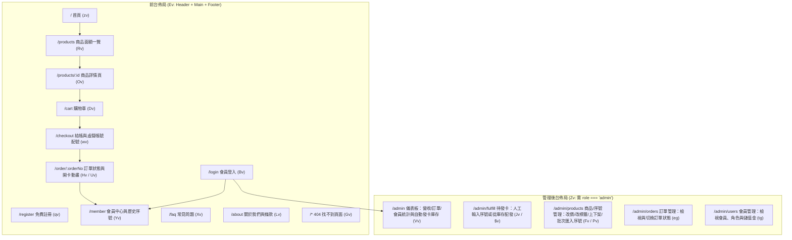

# 寶和科技（baohepoint.com）網站深度分析報告

> 本報告透過 Chrome 瀏覽器實際載入並逐頁操作 `https://www.baohepoint.com/`，結合全站 DOM 快照、視覺截圖、網路 API 請求攔截與前端編譯產物（CSS / JS Bundles）逆向解析，完整拆解該網站的**商業內容、系統架構與視覺設計系統**。

---

## 1. 網站概覽與商業定位

### 1.1 品牌與公司基本資訊
| 項目 | 內容 |
| :--- | :--- |
| **網站名稱** | 寶和科技 ｜ MYCARD 點數卡專賣 |
| **網址** | https://www.baohepoint.com/ |
| **營運主體** | 寶和科技有限公司（BAOHE TECHNOLOGY CO., LTD.） |
| **統一編號** | 83362653 |
| **聯絡電話** | 0909-554-141 |
| **客服信箱** | baohe8728@gmail.com |
| **公司地址** | 桃園市桃園區武陵里005鄰中正路60號地下一層之65 |
| **核心價值主張** | 專營正版 MyCard 遊戲點數卡線上零售，主打「**快、清楚、安心**」：全面約 **95 折（省 5%）** 透明定價、**專人核發把關**、**序號永久可查**（會員中心 + Email 雙重留存）。 |

---

## 2. 內容與商品策略分析（Content & Catalog）

### 2.1 商品結構與定價策略
透過攔截 `/api/products` 介面，目前全站共上架 **17 款 MyCard 點數卡商品**（`category_id: 1`，發貨模式皆標記為 `delivery: "manual"` 專人核發，定價統一為**原價 95 折**，四捨五入至整數）：

| 商品 ID | 商品名稱 | 點數面額 (`face_value`) | 原價 (`original_price`) | 售價 (`price`) | 折扣金額 | 標籤 (`badge`) | 圖片路徑 |
| :---: | :--- | :---: | :---: | :---: | :---: | :---: | :--- |
| `9` | MyCard 90 點 | 90 | NT$90 | **NT$86** | 省 NT$4 | `現貨` | `/images/products/mycard-90.webp` |
| `10` | MyCard 150 點 | 150 | NT$150 | **NT$143** | 省 NT$7 | `熱銷` | `/images/products/mycard-150.webp` |
| `11` | MyCard 170 點 | 170 | NT$170 | **NT$162** | 省 NT$8 | `現貨` | `/images/products/mycard-170.webp` |
| `12` | MyCard 300 點 | 300 | NT$300 | **NT$285** | 省 NT$15 | `現貨` | `/images/products/mycard-300.webp` |
| `13` | MyCard 350 點 | 350 | NT$350 | **NT$333** | 省 NT$17 | `熱銷` | `/images/products/mycard-350.webp` |
| `14` | MyCard 400 點 | 400 | NT$400 | **NT$380** | 省 NT$20 | `現貨` | `/images/products/mycard-400.webp` |
| `15` | MyCard 450 點 | 450 | NT$450 | **NT$428** | 省 NT$22 | `現貨` | `/images/products/mycard-450.webp` |
| `16` | MyCard 500 點 | 500 | NT$500 | **NT$475** | 省 NT$25 | `熱銷` | `/images/products/mycard-500.webp` |
| `17` | MyCard 750 點 | 750 | NT$750 | **NT$713** | 省 NT$37 | `現貨` | `/images/products/mycard-750.webp` |
| `18` | MyCard 1000 點 | 1000 | NT$1,000 | **NT$950** | 省 NT$50 | `熱銷` | `/images/products/mycard-1000.webp` |
| `19` | MyCard 1150 點 | 1150 | NT$1,150 | **NT$1,093** | 省 NT$57 | `現貨` | `/images/products/mycard-1150.webp` |
| `20` | MyCard 1490 點 | 1490 | NT$1,490 | **NT$1,416** | 省 NT$74 | `現貨` | `/images/products/mycard-1490.webp` |
| `21` | MyCard 1690 點 | 1690 | NT$1,690 | **NT$1,606** | 省 NT$84 | `現貨` | `/images/products/mycard-1690.webp` |
| `22` | MyCard 2000 點 | 2000 | NT$2,000 | **NT$1,900** | 省 NT$100 | `超值` | `/images/products/mycard-2000.webp` |
| `23` | MyCard 2500 點 | 2500 | NT$2,500 | **NT$2,375** | 省 NT$125 | `超值` | `/images/products/mycard-2500.webp` |
| `24` | MyCard 3000 點 | 3000 | NT$3,000 | **NT$2,850** | 省 NT$150 | `超值` | `/images/products/mycard-3000.webp` |
| `25` | MyCard 3290 點 | 3290 | NT$3,290 | **NT$3,126** | 省 NT$164 | `超值` | `/images/products/mycard-3290.webp` |

### 2.2 各頁面內容模組拆解

1. **首頁 (`/`)**：採用高轉換率的單頁式銷售漏斗（Landing Funnel）結構，由上至下分為 6 大區塊：
   - **Hero 首屏區**：左側為信任徽章（「正版 MYCARD ・ 專人核發把關」）、主標題「MYCARD 點數 **安心**這裡買」、副標題文案、雙 CTA 按鈕（「選購面額 →」、「了解發卡流程」）與 3 個信任小圖示（SSL 加密交易、專人核發把關、帳號轉帳付款）；右側為 3 張傾斜堆疊且帶上下浮動動畫的 MyCard 卡面（150、500、1000 點）。
   - **熱門面額區 (`#denom`)**：展示前 8 款面額（90～500 點），4 欄網格卡片，支援點擊 `+` 直接加入購物車。
   - **發卡流程區 (`#steps`)**：深色圓角巨型容器（`#1a1714`），以 `01 選擇面額` → `02 付款完成` → `03 序號到手` 三步驟強化「簡單快速」的認知。
   - **品牌優勢區 (`WHY BAOHE`)**：4 張數據/關鍵字卡片（`100%` 正版 MYCARD、`專人` 人工核發把關、`∞` 序號永久可查、`SSL` 金流加密交易）。
   - **精簡常見問題 (`FAQ`)**：雙欄列出買家最關心的 4 個問題（發卡時間、查看位置、付款方式、退費政策）。
   - **底部大型 CTA Banner**：亮橘漸層圓角橫幅「現在就把 MYCARD 帶回家」，引導至 `/products`。

2. **商品面額頁 (`/products`)**：
   - 頂部麵包屑與標題區，右側設有「查我的訂單序號 →」快捷按鈕。
   - **會員促銷橫幅**：「會員回購享儲值金回饋 — 單筆滿 NT$1,000 回饋 1% 儲值金，下次購卡直接折抵（會員專屬）」。
   - **篩選與排序列**：左側膠囊按鈕篩選（`全部`、`熱銷`［含熱銷與超值］、`大面額`［≥1000點］；程式碼中亦預留 `點數卡` 與 `會員儲值序號` 分類邏輯）；右側下拉選單支援 4 種排序（推薦排序、面額低→高、面額高→低、價格低→高）。
   - **商品網格**：4 欄式卡片，包含 640×640 WebP 卡面圖、右上角狀態標籤、商品名稱、「● 現貨供應 ・ 專人發卡」綠字提示、售價與「加入 +」按鈕。

3. **商品詳情頁 (`/products/:id`)**：
   - **上半部雙欄購買區**：左欄為米色柔和背景加橘色光暈的卡面展示框（若無圖片則自動渲染 CSS 擬真黑金晶片卡）；右欄為狀態膠囊、商品名稱、4.9 星評價、現價/原價刪除線/「省 NT$X」綠色標籤、數量增減器、「加入購物車」與「立即購買 →」（點擊直接跳轉 `/checkout`），以及 2×2 信任保障列表。
   - **下半部頁籤區**：包含 `使用教學`（4 步驟儲值說明 + 消保法不退換醒目警告框）、`商品說明`、`退換貨須知` 三個切換頁籤。

4. **購物車 (`/cart`) 與結帳流程 (`/checkout`)**：
   - **購物車**：空車時顯示引導按鈕；有商品時左欄列出清單（橘色漸層小方塊顯示面額、單價、數量調整、小計、刪除鈕），右欄為 Sticky「訂單摘要」（金流處理費 NT$0、應付總額、前往結帳按鈕）。
   - **結帳頁 (`/checkout`)**：
     - 強制要求登入（未登入自動導向 `/login?redirect=%2Fcheckout`）。
     - 頂部 3 步進度條：`① 購物車 (✓)` —— `② 結帳付款` —— `③ 序號到手`。
     - 左欄分為 3 張編號卡片：
       - `[1] 訂購人 & 收件資訊`：姓名、手機號碼、序號寄送 Email（預設帶入會員 Email）。
       - `[2] 發票資訊`：發票類型（固定為「個人電子發票（存載具）」）與統一編號（選填）。
       - `[3] 付款方式`：採用 **ATM 虛擬帳號轉帳（即時配號）**，買家必須先選擇自己的「付款銀行」（內建 25 家台灣常見銀行代碼 `700`、`004`～`822` 及其他手動輸入 3 碼）並填寫「用來轉帳的銀行帳號（6–16 碼純數字）」以供入帳比對。
     - 送出後呼叫 `POST /api/orders` 與 `POST /api/pay`，若立即取得虛擬帳號則當頁顯示轉帳銀行、專屬虛擬帳號（附一鍵複製）、應付金額與付款期限；若為非同步配號，則每 3 秒輪詢 `GET /api/orders/:orderNo` 最多 10 次（30 秒），失敗時提供外部 `pay_url` 連結。

5. **訂單狀態與開卡頁 (`/order/:orderNo`)**：
   - 支援自動輪詢（待付款每 3 秒更新、已付款待發卡每 4 秒更新）。
   - 分為三種視圖狀態：
     1. **等待付款完成**：顯示應付總額與虛擬帳號 (`vatm`) 或超商代碼 (`store`) 資訊。
     2. **付款成功，序號處理中**：提示專人核發把關中，每 4 秒自動檢查。
     3. **付款成功，序號到手！（開卡彈窗 `Uv`）**：全螢幕毛玻璃彈窗，頂部帶金色流光掃描 (`sweep`) 動畫，每張序號卡以 3D 翻轉 (`flip`) 動畫呈現，顯示黑金漸層卡面、序號（附一鍵複製）與 PIN 密碼。

6. **會員系統 (`/login`, `/register`, `/member`)**：
   - 採用 JWT Bearer Token 認證（儲存於 `localStorage.getItem("baohe_token")`）。
   - **會員中心 (`/member`)**：頂部問候語與登出鈕；雙欄數據卡展示「**儲值金餘額 (`store_credit`)**」與「**歷史訂單數**」；下方列出所有歷史訂單明細與已核發之序號/PIN 碼（支援隨時複製）。

7. **常見問題 (`/faq`) 與 關於我們 (`/about`)**：
   - `/faq` 採用手風琴（Accordion）展開收合設計，共 6 題問答。
   - `/about` 包含品牌理念、5 格公司基本資料卡（公司名稱、統編、電話、信箱、地址）、服務條款摘要（4 點）與隱私權政策摘要（3 點）。

---

## 3. 系統與資訊架構分析（Architecture）

### 3.1 技術棧（Tech Stack）
- **前端框架**：React 19（SPA 單頁應用程式）+ React Router v7 (`BrowserRouter`)
- **建置工具**：Vite（產出單一 JS bundle `index-RpYvANsV.js` 約 331 KB 與單一 CSS bundle `index-EoTe63MF.css` 約 43.7 KB）
- **樣式引擎**：Tailwind CSS v4（使用 `@layer theme` 原生 CSS 變數與 OKLCH/Hex 色彩系統）
- **狀態管理**：Zustand（含 `persist` 中介軟體，將購物車持久化於 `localStorage` 的 `baohe_cart` 鍵值）
- **圖示庫**：Lucide React（線條寬度約 `1.8px`～`2px`）
- **基礎設施**：Cloudflare CDN / Proxy + Cloudflare Web Analytics (`beacon.min.js`)，後端 API 掛載於同網域 `/api/*` 路徑下。

### 3.2 全站路由與前後台架構圖
從前端打包程式碼中可完整還原出 **前台 12 個路由** 與 **管理後台 (`/admin`) 5 個子路由**：

### 3.3 後端 REST API 端點清單
| 分類 | HTTP 方法與路徑 | 功能說明 |
| :--- | :--- | :--- |
| **商品** | `GET /api/products` | 取得所有上架商品列表（含面額、售價、原價、標籤、圖片、庫存） |
| **商品** | `GET /api/products/:id` | 取得單一商品詳情 |
| **認證** | `POST /api/auth/login` | 會員/管理員登入，回傳 `{ token, user }` |
| **認證** | `POST /api/auth/register` | 會員註冊（`email`, `password`, `username`），回傳 `{ token, user }` |
| **認證** | `GET /api/auth/me` | 驗證 JWT Token 並取得當前使用者資訊（含 `role`, `store_credit`） |
| **訂單/金流** | `POST /api/orders` | 建立新訂單（傳入訂購人資料、`payment_method: "atm"` 及商品項目） |
| **訂單/金流** | `POST /api/pay` | 發起金流取號（傳入 `orderNo`, `channel: "vatm"`, `payerBankCode`, `bankAccount`） |
| **訂單/金流** | `GET /api/orders` | 取得當前登入會員的所有歷史訂單與已核發序號 |
| **訂單/金流** | `GET /api/orders/:orderNo` | 查詢單筆訂單狀態、付款資訊 (`payment`) 與序號 (`items[].codes`) |
| **管理後台** | `GET /api/admin/stats` | 取得後台儀表板統計（有效訂單數、累計營收、會員數、各商品序號庫存） |
| **管理後台** | `GET /api/admin/orders/pending-issue` | 取得已付款但尚未完成發卡的訂單列表 |
| **管理後台** | `GET /api/admin/orders/:id/detail` | 取得待發卡訂單的細項與已配發數量 |
| **管理後台** | `POST /api/admin/orders/:id/issue` | 執行發卡（支援手動貼上 `序號,密碼` 或從庫存自動配發） |
| **管理後台** | `PUT /api/admin/products/:id` | 修改商品售價 (`price`)、標籤 (`badge`) 與上下架狀態 (`status`) |
| **管理後台** | `POST /api/admin/products/:id/codes` | 批次匯入商品序號庫存（每行一組 `code,pin`） |
| **管理後台** | `GET /api/admin/orders` | 取得全站所有訂單列表 |
| **管理後台** | `PUT /api/admin/orders/:id/status` | 變更訂單狀態（`pending` / `paid` / `completed` / `cancelled` / `refunded`） |
| **管理後台** | `GET /api/admin/users` | 取得全站會員列表（含角色與儲值金餘額） |

---

## 4. 視覺與 UI/UX 設計系統分析（Design System）

### 4.1 設計風格定調
網站跳脫傳統遊戲點數網站常見的「暗黑霓虹電競風」或「雜亂促銷風」，採用**溫暖奶油米白底色 + 炭黑墨色文字 + 活力亮橘與暖金點綴**的現代精品電商風格（Warm Editorial E-Commerce）。視覺層次乾淨、留白充裕，將「買點數卡」塑造成如同精品金融或現代數位服務般「透明、可信賴、無壓力」的體驗。

### 4.2 色彩系統（Color Tokens）
定義於 CSS `@layer theme` 的核心設計變數：

| CSS 變數名稱 | 色碼 (Hex) | 用途說明 |
| :--- | :---: | :--- |
| `--color-bg` | `#faf8f4` | 全站主背景色（溫暖燕麥奶油白），降低視覺疲勞 |
| `--color-card` | `#ffffff` | 卡片、表單輸入框與彈窗表面純白底色 |
| `--color-ink` | `#1a1714` | 主文字色、深色區塊背景、次要按鈕背景（帶暖調的深炭黑） |
| `--color-muted` | `#6e665c` | 次要說明文字、麵包屑、輔助圖示顏色（暖灰褐） |
| `--color-line` | `#e7e0d6` | 卡片邊框、分隔線、表格框線（柔和米灰線條） |
| `--color-orange` | `#ff6a1a` | 品牌主色、主要 CTA 按鈕、強調標記、購物車數量徽章 |
| `--color-orange-deep` | `#e2530a` | 價格數字、標題強調字、橘色徽章文字、按鈕 Hover 深橘色 |
| `--color-gold` | `#f4b740` | 品牌輔助金色（Logo 漸層、深色區塊小標題、星級評分、會員專屬標籤） |
| `--color-ok` | `#1e9e6a` | 信任與狀態綠（「現貨」標籤、「省 NT$X」標籤、SSL 加密圖示、完成勾選） |
| *深色區塊底色* | `#15120f` / `#2a2118` | Footer 頁尾、後台側邊欄、黑金擬真點數卡面漸層底色 |
| *商品卡底襯色* | `#f6f2ec` | 商品列表與詳情頁圖片展示區的暖米灰襯底 |

### 4.3 字體排印系統（Typography）
透過 Google Fonts 引入三款字體，並利用工具類別精準分工：
1. **中文與內文字體 (`--font-sans`)**：`"Noto Sans TC", system-ui, sans-serif`（字重載入 400, 500, 700, 900）。大標題一律使用 `font-black (900)` 搭配緊湊字距 `tracking-[-0.02em]` 至 `[-0.025em]`，力量感極強。
2. **英文與價格展示字體 (`--font-display` / `.en`)**：`"Sora", sans-serif`（字重 600, 700, 800）。所有 `NT$` 價格、百分比、步驟編號（`01`, `02`, `03`）與英文 Kicker 小標題（如 `CHOOSE YOUR CARD`, `HOW IT WORKS`）皆套用 `.en`，呈現現代幾何無襯線質感。
3. **等寬序號字體 (`--font-mono` / `.mono`)**：`"JetBrains Mono", monospace`（字重 600, 800）。專用於訂單編號、ATM 虛擬帳號、點數卡儲值序號與 PIN 碼，確保字元清晰易讀不混淆。
4. **對齊數字 (`.num`)**：設定 `font-variant-numeric: tabular-nums`，確保價格、庫存與計數器數字等寬對齊。

#### 字級階層（Type Scale）
- **Hero 主標題 (`H1`)**：桌機 `60px` / 手機 `42px`，行高 `1.05`，字重 `900`
- **子頁主標題 (`H1`)**：`38px`～`40px`，字重 `900`
- **區塊標題 (`H2`)**：`34px`（CTA 橫幅為 `38px`），字重 `900`
- **英文導引小標 (Kicker)**：`13px`，全大寫 `uppercase`，字距 `0.1em`，字重 `700`
- **商品詳情售價**：`42px`（列表卡片售價為 `21px`），字重 `800`
- **內文與表單**：基礎 `15px`～`16px`，行高 `1.6`～`1.9`

### 4.4 版面網格與元件設計規範（Layout & Components）
- **最大容器寬度**：主內容區 `max-w-[1240px]`（購物車/結帳/會員中心為 `1100px`，關於我們 `820px`，FAQ `760px`，登入註冊卡片 `440px`），水平內距 `px-6 (24px)`。
- **導覽列 (Header)**：高度 `68px`，固定置頂 (`sticky top-0 z-50`)，採用毛玻璃特效 `backdrop-blur-md bg-[rgba(250,248,244,0.82)]` 搭配底部細線 `border-line`。
- **圓角規範 (Border Radius)**：
  - 大型區塊與重點彈窗：`rounded-3xl (24px)` 或 `rounded-[28px]`
  - 商品卡片與內容面板：`rounded-2xl (16px)` 或 `rounded-[18px]`
  - 按鈕與表單輸入框：`rounded-xl (12px)`
  - 狀態標籤與小按鈕：`rounded-md (6px)`～`rounded-[9px]`
- **陰影與立體感 (Shadows)**：
  - 主按鈕橘色光暈：`shadow-[0_6px_18px_rgba(255,106,26,0.30)]`
  - 商品卡片 Hover 浮起：`hover:-translate-y-1 hover:shadow-[0_16px_34px_-14px_rgba(26,23,20,0.22)] hover:border-orange/40`
  - 首頁漂浮點數卡深邃投影：`shadow-[0_24px_50px_-12px_rgba(26,23,20,0.4)]`

### 4.5 動畫與微互動設計（Motion & Micro-interactions）
網站內建 6 組精心設計的 CSS Keyframes 與捲動觸發機制，並支援無障礙 `prefers-reduced-motion: reduce`：
1. **捲動漸入 (`.reveal` + `IntersectionObserver`)**：當區塊進入視窗 `12%` 時加上 `.in` 類別，由 `opacity: 0; translateY(18px)` 平滑過渡至原位（曲線 `cubic-bezier(0.2, 0.7, 0.3, 1)`，同排卡片依序延遲 `0ms, 60ms, 120ms, 180ms`）。
2. **首頁卡片漂浮 (`@keyframes floaty`)**：6 秒無限循環上下微幅浮動 (`translateY(-12px)`)，3 張卡片分別設定 `0s, -2s, -4s` 相位差。
3. **呼吸燈號 (`@keyframes pulse`)**：用於首頁信任徽章與訂單輪詢狀態的橘色圓點外擴光圈。
4. **開卡成功彈跳 (`@keyframes pop`)**、**金色流光掃過 (`@keyframes sweep`)** 與 **3D 序號卡翻轉 (`@keyframes flip`)**：在買家拿到序號的瞬間提供極具儀式感的「開箱爽感」。

---

## 5. 現況亮點與潛在優化觀察

### 5.1 設計與架構亮點
- **高信任感視覺語言**：暖白配橘金的色調、清楚標示公司統編/地址/電話、以及無處不在的「SSL 加密、專人把關、永久可查」視覺錨點，非常有效化解點數卡買家對詐騙的戒心。
- **極簡且完整的閉環系統**：前端單一檔案不到 340KB 即完整涵蓋「前台商城 + 虛擬帳號配號輪詢 + 即時開卡動畫 + 會員中心 + 管理員後台（發卡/改價/庫存匯入）」，架構極為輕巧高效。
- **優秀的防呆細節**：例如結帳時強制驗證付款銀行 3 碼與轉帳帳號 6–16 碼純數字、非同步配號時提醒「請勿重複下單」、序號顯示處皆提供「一鍵複製」狀態回饋。

### 5.2 可進一步優化的細節（UX / 技術面觀察）
1. **行動版漢堡選單缺失**：Header 的導覽連結 (`nav`) 設定了 `hidden md:flex`，且「登入」按鈕設定了 `hidden md:inline-flex`；在手機版（`< 768px`）畫面中，頂部僅剩 Logo、購物車圖示與「立即購買」按鈕，缺少漢堡選單（Mobile Drawer）或直接進入「登入／會員中心」的頂部入口。
2. **SEO 與動態 Meta Title**：全站所有路由的 `document.title` 皆固定為 `寶和科技 ｜ MYCARD 點數卡專賣`，且為純 CSR（Client-Side Rendering）架構；若需強化搜尋引擎自然流量，可為各面額商品頁動態更新 `<title>`、Open Graph 標籤與 `Product` JSON-LD 結構化資料。
3. **儲值金折抵介面連動**：雖然商品頁宣傳「單筆滿 NT$1,000 回饋 1% 儲值金，下次購卡直接折抵」且會員中心看得到 `store_credit` 餘額，但目前 `/checkout` 結帳表單尚未顯示「使用儲值金折抵」的勾選或輸入欄位。
4. **後台庫存顯示與手動發卡模式**：目前 17 項商品的 `delivery` 皆為 `"manual"` 且 `stock: 0`，而後台儀表板標題寫「庫存概況（自動發卡品項）」，兩者可依據實際營運以人工或自動發卡為主做更清晰的狀態區分。
